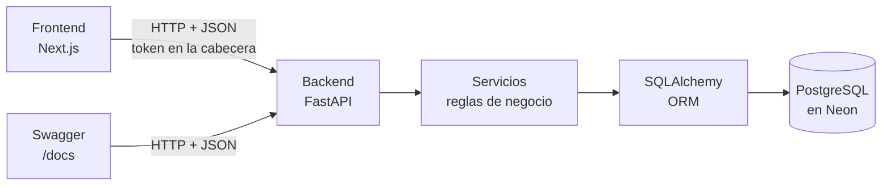
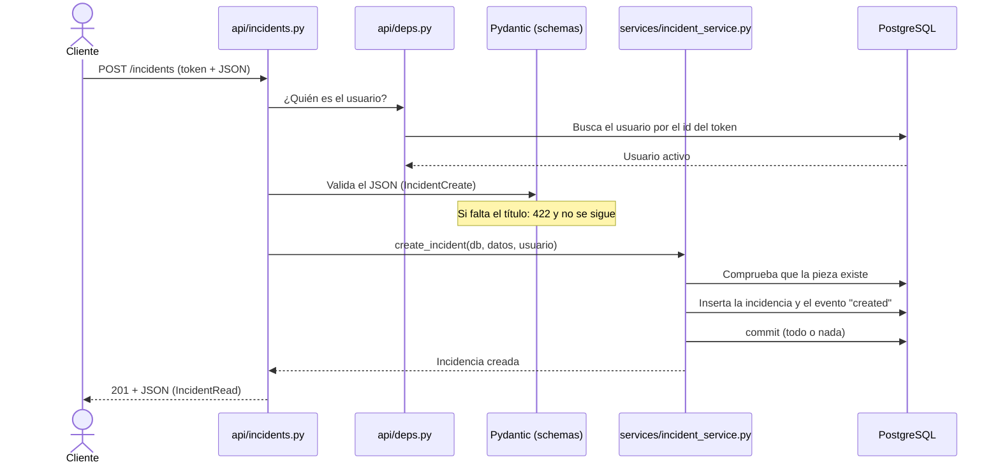
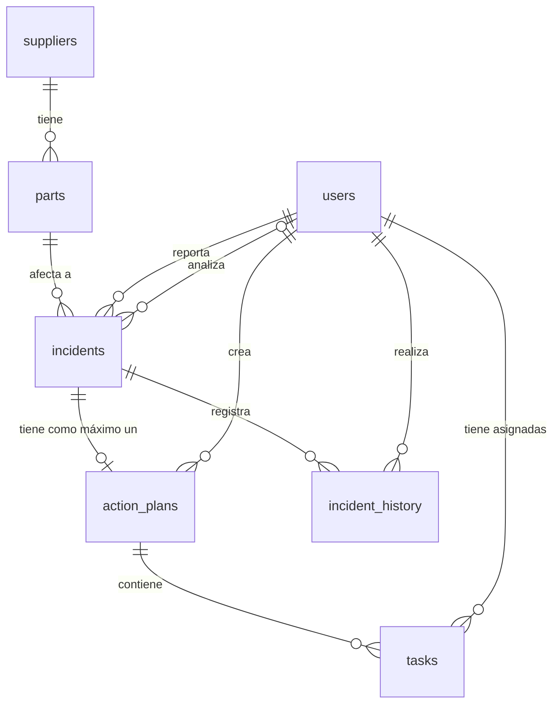
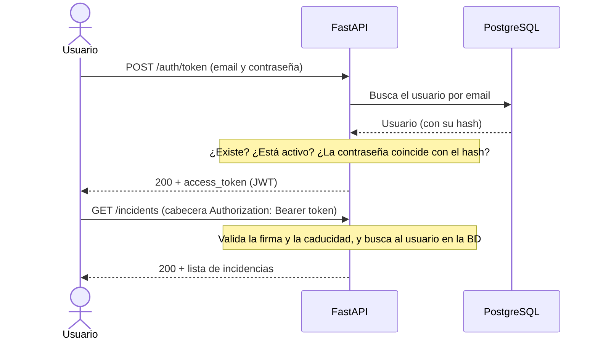
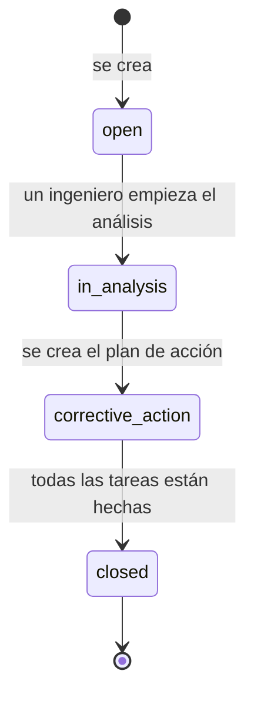
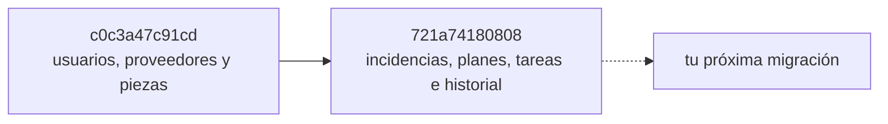

# SupplyGuard · Documentación del backend

> Proyecto personal (portfolio) inspirado en la gestión de calidad *incoming* de una fábrica: registrar, analizar, resolver y medir las incidencias de piezas defectuosas que llegan de los proveedores.

| | |
|---|---|
| **Versión de la API** | 0.1.0 |
| **Lenguaje** | Python 3.13 o superior |
| **Framework** | FastAPI + Pydantic |
| **Base de datos** | PostgreSQL alojado en Neon (acceso con SQLAlchemy 2.0 y Alembic) |
| **Estado** | Fases 0 y 1 terminadas: modelo de datos, API completa, login con roles y 69 tests |

Esta documentación está pensada para quien empieza con Python y FastAPI. Cada término técnico se explica la primera vez que aparece, hay comparaciones con C# y Java, y al final tienes un glosario.

> [!NOTE]
> Los diagramas usan **Mermaid**. GitHub los dibuja solo. En VS Code instala la extensión *Markdown Preview Mermaid Support* para verlos en la vista previa.

## Cómo leer este documento

| Si quieres... | Ve a... |
|---|---|
| Arrancar el proyecto cuanto antes | [2. Puesta en marcha](#2-puesta-en-marcha) |
| Entender cómo está montado | [3. Stack](#3-stack-tecnológico) y [4. Arquitectura](#4-arquitectura-del-código) |
| Consultar un endpoint concreto | [7. Referencia de la API](#7-referencia-de-la-api) |
| Programar una funcionalidad nueva | [8. Reglas de negocio](#8-reglas-de-negocio) y [13. Guías prácticas](#13-guías-prácticas) |
| Resolver un error | [16. Resolución de problemas](#16-resolución-de-problemas) |
| Saber qué significa una palabra | [17. Glosario](#17-glosario) |

## Índice

1. [Visión general](#1-visión-general)
2. [Puesta en marcha](#2-puesta-en-marcha)
3. [Stack tecnológico](#3-stack-tecnológico)
4. [Arquitectura del código](#4-arquitectura-del-código)
5. [Modelo de datos](#5-modelo-de-datos)
6. [Autenticación y autorización](#6-autenticación-y-autorización)
7. [Referencia de la API](#7-referencia-de-la-api)
8. [Reglas de negocio](#8-reglas-de-negocio)
9. [Gestión de errores](#9-gestión-de-errores)
10. [La base de datos en la práctica](#10-la-base-de-datos-en-la-práctica)
11. [Tests](#11-tests)
12. [Calidad de código](#12-calidad-de-código)
13. [Guías prácticas](#13-guías-prácticas)
14. [Decisiones de diseño](#14-decisiones-de-diseño)
15. [Limitaciones y próximos pasos](#15-limitaciones-y-próximos-pasos)
16. [Resolución de problemas](#16-resolución-de-problemas)
17. [Glosario](#17-glosario)
18. [Recursos para aprender más](#18-recursos-para-aprender-más)

---

## 1. Visión general

### 1.1 ¿Qué es el backend?

Una aplicación web se divide en dos partes:

- **Frontend**: lo que ves y tocas (pantallas, botones, formularios).
- **Backend**: la parte que no se ve. Guarda los datos, aplica las reglas y decide quién puede hacer qué.

> [!TIP]
> **Analogía del restaurante.** El frontend es el comensal que pide. La API es el camarero que lleva los pedidos. Los servicios son la cocina, donde se aplican las recetas. La base de datos es la despensa. Y el login con los roles es el portero que mira si estás en la lista.

El frontend nunca toca la base de datos directamente: le pide cosas al backend, y el backend decide si se pueden hacer.

**¿Qué es una API?** Es la "carta" del restaurante: la lista de cosas que se pueden pedir al backend. Cada una se llama **endpoint** y tiene dos partes:

- Un **verbo** HTTP: `GET` (consultar), `POST` (crear), `PATCH` (modificar parte de algo) o `DELETE` (borrar).
- Una **ruta**, por ejemplo `/incidents`.

`GET /incidents` significa "dame la lista de incidencias". `POST /incidents` significa "crea una incidencia". Los datos viajan en **JSON**, un formato de texto como este: `{"id": 1, "title": "Agujeros descentrados"}`.

### 1.2 Arquitectura general



Cómo encaja con el frontend:

- El frontend de Next.js llama a la API **desde su propio servidor** y guarda el token en una cookie `httpOnly` (JavaScript del navegador no puede leerla). Por eso el backend no necesita configurar CORS (explicado en el [glosario](#17-glosario)).
- Los indicadores (KPIs) del panel se calculan hoy en el frontend a partir de `GET /incidents`. Está pendiente moverlos a un endpoint del backend.

### 1.3 Qué hay hecho y qué falta

| Hecho | Pendiente |
|---|---|
| Usuarios con roles y login con JWT | Endpoint de KPIs |
| Proveedores y piezas | Ficha de incidencia en PDF |
| Incidencias con flujo de estados | Avisos a Teams o Discord |
| Planes de acción y tareas | Exportación a BigQuery |
| Historial de cambios | Subida real de fotos |
| 69 tests automáticos | Paginación y GitHub Actions |

---

## 2. Puesta en marcha

### 2.1 Requisitos

- **Python 3.13 o superior** (`python --version`).
- Una base de datos **PostgreSQL**. El proyecto usa [Neon](https://neon.tech), que ofrece un plan gratuito y no hay que instalar nada.
- Idealmente, una segunda base de datos (una *rama* en Neon) solo para los tests.

### 2.2 Instalación paso a paso

Desde la raíz del repositorio, en PowerShell:

```powershell
# 1. Crear el archivo de configuración a partir de la plantilla
copy .env.example .env

# 2. Entrar en el backend y crear el entorno virtual
cd backend
python -m venv .venv

# 3. Activar el entorno virtual
.venv\Scripts\Activate.ps1

# 4. Instalar el proyecto y sus dependencias (incluidas las de desarrollo)
pip install -e ".[dev]"
```

En macOS o Linux el paso 1 es `cp .env.example .env` y el 3 es `source .venv/bin/activate`.

> [!NOTE]
> **¿Qué es un entorno virtual (`venv`)?** Es una carpeta con las librerías de este proyecto, aislada del resto de tu ordenador. Equivale a las dependencias de un `.csproj` o un `pom.xml`, pero se activa a mano. Si no está activado, los comandos no encontrarán las librerías. `pip install -e` instala el proyecto en modo "editable": los cambios que hagas en el código se aplican sin reinstalar.

### 2.3 Configuración (`.env`)

Edita el archivo `.env`. **Nunca lo subas a git** (ya está en `.gitignore`).

| Variable | Obligatoria | Qué es |
|---|:-:|---|
| `DATABASE_URL` | Sí | Cadena de conexión a la base de datos principal |
| `TEST_DATABASE_URL` | No | Base de datos solo para tests. Si falta, los tests que usan BD se saltan |
| `JWT_SECRET_KEY` | Sí | Clave secreta con la que se firman los tokens |
| `ACCESS_TOKEN_EXPIRE_MINUTES` | No | Duración del token en minutos (por defecto 60) |

Dos detalles que fallan mucho al empezar:

1. **El prefijo de la URL.** Neon te da una URL que empieza por `postgresql://`. Cámbiala a `postgresql+psycopg://` para que SQLAlchemy use el driver `psycopg`. Mantén `?sslmode=require` al final: Neon solo acepta conexiones cifradas.
2. **La clave JWT.** Genera una aleatoria con `python -c "import secrets; print(secrets.token_hex(32))"` y pégala en `JWT_SECRET_KEY`. Quien la conozca podría fabricar tokens falsos.

La aplicación busca `.env` primero en la raíz del repositorio (`../.env`) y después en `backend/.env`. Si una variable está en los dos, gana el de `backend/`. Ejecuta siempre los comandos desde la carpeta `backend/`.

### 2.4 Preparar la base de datos

```powershell
# Crear las tablas
alembic upgrade head

# Crear el primer administrador (te pide la contraseña sin mostrarla)
python -m app.scripts.create_admin --email admin@example.com --name "Admin"

# Opcional: cargar datos de demostración (usuarios, proveedores, piezas e incidencias)
python -m app.scripts.seed_demo
```

> [!NOTE]
> El script de demo crea cinco usuarios (`operario@demo.com`, `operario2@demo.com`, `ingeniero@demo.com`, `ingeniero2@demo.com` y `admin@demo.com`) con la contraseña `demo1234`. Si los datos de demo ya existen, el script no hace nada. Úsalo solo en desarrollo.

### 2.5 Arrancar la API y comprobar que funciona

```powershell
uvicorn app.main:app --reload
```

- `app.main:app` significa "el objeto `app` que está en el archivo `app/main.py`".
- `--reload` reinicia el servidor al guardar cambios (como `dotnet watch`).

Comprueba que todo va bien:

| Dirección | Qué deberías ver |
|---|---|
| `http://localhost:8000/health` | `{"status": "ok", "database": "ok"}` (confirma también que llega a la base de datos) |
| `http://localhost:8000/docs` | **Swagger**: página con todos los endpoints y un botón *Try it out* para probarlos |

> [!TIP]
> Para probar endpoints protegidos en Swagger: pulsa **Authorize**, escribe el email en `username` y la contraseña, y todas las peticiones llevarán tu token.

### 2.6 Comandos habituales

Todos desde `backend/` y con el entorno virtual activado.

| Para... | Comando |
|---|---|
| Arrancar la API | `uvicorn app.main:app --reload` |
| Ejecutar los tests | `pytest` |
| Revisar el estilo del código | `ruff check .` |
| Crear una migración | `alembic revision --autogenerate -m "mensaje"` |
| Aplicar migraciones | `alembic upgrade head` |
| Migrar la BD de tests | `alembic -x db=test upgrade head` |
| Crear el primer admin | `python -m app.scripts.create_admin --email ... --name "..."` |
| Cargar datos de demo | `python -m app.scripts.seed_demo` |

---

## 3. Stack tecnológico

### 3.1 Qué hace cada pieza

| Herramienta | Su trabajo |
|---|---|
| **Python** | El lenguaje en el que está escrito todo |
| **FastAPI** | El esqueleto de la API: define los endpoints y genera la página de pruebas (Swagger) |
| **Uvicorn** | El servidor que arranca la aplicación y escucha las peticiones |
| **Pydantic** | Valida los datos que entran y salen (un email con forma de email, un título no vacío...) |
| **pydantic-settings** | Lee la configuración desde variables de entorno y el archivo `.env` |
| **PostgreSQL** | La base de datos donde se guardan los datos de forma permanente |
| **Neon** | Servicio en internet que aloja PostgreSQL por nosotros |
| **SQLAlchemy 2.0** | El "traductor" entre objetos Python y la base de datos (un ORM) |
| **psycopg** | El *driver*: el conector que habla con PostgreSQL |
| **Alembic** | Control de versiones de la estructura de la base de datos (migraciones) |
| **PyJWT** | Crea y comprueba los tokens del login |
| **pwdlib (Argon2)** | Convierte las contraseñas en un *hash* irreversible antes de guardarlas |
| **email-validator** | Comprueba que un email es válido (lo usa Pydantic) |
| **python-multipart** | Permite leer el formulario del login |
| **pytest + httpx** | Ejecutan los tests automáticos |
| **ruff** | Revisa el estilo del código y detecta errores típicos |

### 3.2 Equivalencias con lo que ya conoces

| C# / ASP.NET Core | Java / Spring Boot | Este proyecto |
|---|---|---|
| Controller | `@RestController` | **Router** (`APIRouter`) en `api/` |
| `[Authorize(Roles = "...")]` | `@PreAuthorize` | `require_roles(...)` en `api/deps.py` |
| Inyección de dependencias | `@Autowired` | `Depends(...)` de FastAPI |
| `DbContext` (por petición) | `EntityManager` | `Session` de SQLAlchemy (por petición) |
| Entidad | `@Entity` | **Modelo** de SQLAlchemy en `models/` |
| DTO con validaciones | DTO + `@Valid` | **Schema** de Pydantic en `schemas/` |
| `appsettings.json` | `application.properties` | `.env` + `core/config.py` |
| Filtro de excepciones | `@ControllerAdvice` | `@app.exception_handler` en `main.py` |
| Migraciones de EF | Flyway / Liquibase | Alembic |
| xUnit + `WebApplicationFactory` | JUnit + MockMvc | pytest + `TestClient` |
| `.csproj` / NuGet | `pom.xml` / Maven | `pyproject.toml` / pip |
| Swashbuckle | springdoc | Swagger integrado en `/docs` |

### 3.3 Cinco ideas de Python y FastAPI que verás por todas partes

**1. Anotaciones de tipo.** Python no obliga a declarar tipos, pero aquí se usan siempre. FastAPI los lee para validar datos y generar la documentación.

```python
def get_incident(db: Session, incident_id: int) -> Incident:
```

`str | None` significa "texto o nada" (como `string?` en C#).

**2. `Depends` (inyección de dependencias).** Una *dependencia* es una función que FastAPI ejecuta **antes** del endpoint y cuyo resultado entrega como parámetro. Así se obtiene la sesión de base de datos o el usuario actual sin escribir código repetido.

```python
DbSession = Annotated[Session, Depends(get_db)]   # "una Session, obtenida con get_db"

def create_incident(data: IncidentCreate, db: DbSession, current_user: CurrentUser): ...
```

**3. `yield` en una dependencia.** El código antes de `yield` prepara algo y el de después limpia. Equivale a `using` en C# o *try-with-resources* en Java.

```python
def get_db():
    db = SessionLocal()
    try:
        yield db        # el endpoint usa la sesión aquí
    finally:
        db.close()      # siempre se cierra, aunque haya un error
```

**4. `def` normal en vez de `async def`.** Este proyecto usa funciones normales y una sesión de SQLAlchemy síncrona. FastAPI ejecuta cada endpoint `def` en un hilo aparte, así que unas peticiones no bloquean a otras. Es lo más sencillo para empezar. Pasar a `async` es posible más adelante.

**5. Dos tipos de "modelo".** Pydantic y SQLAlchemy usan la palabra *modelo* para cosas distintas:

| | Qué describe | Dónde vive | Ejemplo |
|---|---|---|---|
| **Schema** (Pydantic) | La forma de los datos que viajan por HTTP | `schemas/` | `IncidentCreate`, `IncidentRead` |
| **Modelo** (SQLAlchemy) | Una tabla de la base de datos | `models/` | `Incident` |

Están separados a propósito: así nunca se devuelve por error el `password_hash`, y se puede pedir distinta información al crear, al leer y al modificar. `from_attributes=True` en un schema le permite leer directamente un objeto de SQLAlchemy.

---

## 4. Arquitectura del código

### 4.1 Las capas

El código está en `backend/app/`, dividido en **capas**. Cada una tiene un único trabajo:

| Capa | Carpeta | Su trabajo | No debe... |
|---|---|---|---|
| **API** | `api/` | Recibir la petición, comprobar el token y los permisos, llamar al servicio | Contener reglas de negocio ni consultas a la BD |
| **Schemas** | `schemas/` | Definir y validar los datos que entran y salen | Saber nada de la base de datos |
| **Servicios** | `services/` | Aplicar las reglas del negocio y hablar con la BD | Importar nada de HTTP (ni `HTTPException`) |
| **Modelos** | `models/` | Describir las tablas y sus relaciones | Contener lógica de negocio |
| **Núcleo** | `core/` | Configuración, conexión a BD, seguridad, excepciones propias | Depender de las demás capas |
| **Scripts** | `scripts/` | Programas que se lanzan a mano | |

**¿Por qué tanta separación?** Para que cada archivo haga una sola cosa. Si cambia una regla, tocas `services/`. Si cambia una tabla, `models/`. Y como los servicios no saben nada de HTTP, los reutilizan tanto la API como los scripts (`create_admin` llama al mismo servicio que `POST /users`) y se pueden probar sin levantar un servidor.

### 4.2 Estructura de carpetas

```
backend/
├── app/
│   ├── main.py                  # Crea la app, registra los routers y traduce errores a HTTP
│   ├── api/
│   │   ├── deps.py              # Dependencias: sesión de BD, usuario actual, control de roles
│   │   ├── auth.py              # POST /auth/token, GET /auth/me
│   │   ├── users.py             # /users (solo admin)
│   │   ├── suppliers.py         # /suppliers
│   │   ├── parts.py             # /parts
│   │   ├── incidents.py         # /incidents
│   │   ├── action_plans.py      # /action-plans, /assignees y el plan de cada incidencia
│   │   └── tasks.py             # /tasks
│   ├── schemas/                 # Un archivo por entidad (Create, Update, Read)
│   ├── services/                # Un archivo por entidad con sus reglas de negocio
│   │   └── incident_history_service.py   # Anota los eventos en el historial
│   ├── models/                  # Un archivo por tabla + enums.py y base.py
│   ├── core/
│   │   ├── config.py            # Settings: lee el .env
│   │   ├── database.py          # Engine, SessionLocal y get_db
│   │   ├── security.py          # Hash de contraseñas y creación/lectura de JWT
│   │   └── exceptions.py        # NotFoundError, ConflictError, BusinessRuleError...
│   └── scripts/                 # create_admin.py, seed_demo.py
├── alembic/                     # Migraciones de la base de datos
│   └── versions/                # Un archivo por cambio de estructura
├── tests/                       # Tests automáticos
├── alembic.ini
└── pyproject.toml               # Dependencias y configuración de pytest y ruff
```

### 4.3 El recorrido de una petición

Esto es lo que pasa en `POST /incidents` (crear una incidencia):



1. **Llega la petición** con el token y los datos.
2. **`api/` identifica al usuario.** Lee el token y busca al usuario en la base de datos.
3. **Pydantic valida los datos.** Si algo es inválido, responde 422 sin llegar más lejos.
4. **El servicio aplica las reglas.** Comprueba que la pieza existe, crea la incidencia, anota el evento en el historial y hace `commit`.
5. **La respuesta se filtra** con el schema de salida (`IncidentRead`), así que solo salen los campos permitidos.
6. **Si algo falla**, el servicio lanza un error propio (por ejemplo `NotFoundError`) y `main.py` lo convierte en el código HTTP correcto (404). Los servicios no necesitan saber nada de HTTP.

El código real de cada paso:

```python
# api/incidents.py: solo recibe, delega y devuelve
@router.post("", response_model=IncidentRead, status_code=status.HTTP_201_CREATED)
def create_incident(data: IncidentCreate, db: DbSession, current_user: CurrentUser):
    return incident_service.create_incident(db, data, current_user)
```

```python
# schemas/incident_schema.py: qué datos se aceptan
class IncidentCreate(BaseModel):
    model_config = ConfigDict(str_strip_whitespace=True)   # quita espacios sobrantes

    part_id: int
    title: str = Field(min_length=1, max_length=150)
    description: str = Field(min_length=1)
    severity: Severity                                      # solo low, medium, high o critical
    photo_url: str | None = Field(default=None, max_length=500)
```

```python
# services/incident_service.py: las reglas y la base de datos
def create_incident(db: Session, data: IncidentCreate, current_user: User) -> Incident:
    part_service.get_part(db, data.part_id)          # lanza NotFoundError si no existe
    incident = Incident(**data.model_dump(), reported_by_id=current_user.id)
    db.add(incident)
    record_event(db, incident, current_user, "created", to_status=IncidentStatus.OPEN)
    db.commit()                                       # guarda incidencia y evento a la vez
    db.refresh(incident)                              # recarga los valores generados (id, fecha...)
    return incident
```

---

## 5. Modelo de datos

Una **tabla** es como una hoja de Excel: cada columna es un campo y cada fila, un registro.

### 5.1 Diagrama de relaciones



Se lee así: un proveedor tiene muchas piezas. Una pieza puede tener muchas incidencias. Una incidencia tiene como máximo un plan de acción, y un plan tiene muchas tareas. Los usuarios aparecen en varios sitios: quien reporta la incidencia, quien la analiza, quien crea el plan, a quién se asigna cada tarea y quién hizo cada cambio del historial.

### 5.2 Las tablas

**`users`**: las personas que usan la app.

| Columna | Tipo | Restricciones | Notas |
|---|---|---|---|
| `id` | entero | clave primaria | |
| `email` | texto (255) | único | |
| `full_name` | texto (100) | | |
| `password_hash` | texto (255) | | Nunca la contraseña real |
| `role` | texto (30) | solo `operator`, `engineer`, `admin` | |
| `is_active` | booleano | por defecto `true` | Los usuarios se desactivan, no se borran |
| `created_at` | fecha y hora con zona | por defecto `now()` | |

**`suppliers`**: los proveedores.

| Columna | Tipo | Restricciones |
|---|---|---|
| `id` | entero | clave primaria |
| `name` | texto (100) | único |
| `contact_email` | texto (255) | opcional |
| `is_active` | booleano | por defecto `true` |

**`parts`**: las piezas (una referencia de un proveedor en un lote concreto).

| Columna | Tipo | Restricciones |
|---|---|---|
| `id` | entero | clave primaria |
| `supplier_id` | entero | clave foránea a `suppliers`, con índice |
| `reference` | texto (50) | |
| `lot` | texto (50) | |
| `description` | texto (255) | opcional |
| | | **Única la combinación** `supplier_id` + `reference` + `lot` |

**`incidents`**: los problemas detectados.

| Columna | Tipo | Restricciones | Notas |
|---|---|---|---|
| `id` | entero | clave primaria | |
| `part_id` | entero | clave foránea a `parts`, con índice | |
| `reported_by_id` | entero | clave foránea a `users` | Quién la creó |
| `analyzed_by_id` | entero | clave foránea a `users`, opcional | Se rellena al pasar a análisis |
| `title` | texto (150) | | |
| `description` | texto largo | | |
| `severity` | texto (30) | `low`, `medium`, `high`, `critical` | |
| `status` | texto (30) | `open`, `in_analysis`, `corrective_action`, `closed`; por defecto `open`; con índice | |
| `photo_url` | texto (500) | opcional | Hoy solo guarda un enlace |
| `created_at` | fecha y hora con zona | por defecto `now()` | |
| `closed_at` | fecha y hora con zona | opcional | Se rellena al cerrar |

**`action_plans`**: el plan para resolver una incidencia.

| Columna | Tipo | Restricciones |
|---|---|---|
| `id` | entero | clave primaria |
| `incident_id` | entero | clave foránea a `incidents`, **único** (un plan por incidencia) |
| `created_by_id` | entero | clave foránea a `users` |
| `description` | texto largo | |
| `created_at` | fecha y hora con zona | por defecto `now()` |

**`tasks`**: cada tarea de un plan.

| Columna | Tipo | Restricciones | Notas |
|---|---|---|---|
| `id` | entero | clave primaria | |
| `action_plan_id` | entero | clave foránea a `action_plans`, con índice | |
| `assigned_to_id` | entero | clave foránea a `users`, con índice | El responsable |
| `title` | texto (150) | | |
| `due_date` | fecha | | Fecha límite (sin hora) |
| `completed_at` | fecha y hora con zona | opcional | Si tiene valor, la tarea está hecha |

**`incident_history`**: el diario de cada incidencia (quién hizo qué y cuándo).

| Columna | Tipo | Restricciones | Notas |
|---|---|---|---|
| `id` | entero | clave primaria | |
| `incident_id` | entero | clave foránea a `incidents`, con índice | |
| `user_id` | entero | clave foránea a `users` | Quién lo hizo |
| `action` | texto (100) | | Ver la lista de acciones más abajo |
| `from_status` | texto (30) | opcional | Estado anterior, si cambió |
| `to_status` | texto (30) | opcional | Estado nuevo, si cambió |
| `created_at` | fecha y hora con zona | por defecto `now()` | |

Valores posibles de `action`: `created`, `updated`, `status_changed`, `action_plan_created`, `action_plan_updated`, `task_added`, `task_updated`, `task_completed`, `task_reopened`, `task_deleted`.

### 5.3 Reglas que garantiza la propia base de datos

La base de datos es la última línea de defensa: aunque el código tuviera un fallo, estas reglas no se pueden saltar.

- **Valores cerrados.** Roles, severidades y estados se guardan como texto con una restricción `CHECK` que solo admite los valores de la lista. Si intentas guardar `"urgente"`, la base de datos lo rechaza.
- **Unicidad.** No puede haber dos usuarios con el mismo email, dos proveedores con el mismo nombre, dos piezas iguales (proveedor + referencia + lote) ni dos planes para la misma incidencia.
- **Integridad referencial.** Una clave foránea impide, por ejemplo, crear una incidencia de una pieza que no existe.
- **Fechas con zona horaria.** Todas las marcas de tiempo guardan la zona, para que no haya confusiones.
- **Nombres de restricciones predecibles.** Los índices y restricciones siguen una convención (`pk_<tabla>`, `uq_<tabla>_<columna>`, `fk_...`, `ck_...`, `ix_...`) definida en `models/base.py`. Así las migraciones de Alembic son reproducibles.

### 5.4 Los valores fijos (enums)

| Enum | Valores |
|---|---|
| `Role` | `operator` (operario), `engineer` (ingeniero), `admin` |
| `Severity` | `low` (baja), `medium` (media), `high` (alta), `critical` (crítica) |
| `IncidentStatus` | `open` (abierta), `in_analysis` (en análisis), `corrective_action` (acción correctiva), `closed` (cerrada) |

Se definen una sola vez en `models/enums.py`. Los usan los modelos, los schemas y los servicios, así que un valor inventado no entra por ningún sitio.

---

## 6. Autenticación y autorización

Dos conceptos que se confunden:

- **Autenticación**: *¿quién eres?* (el login).
- **Autorización**: *¿qué puedes hacer?* (los roles).

### 6.1 El flujo del login

> [!TIP]
> **Analogía de la discoteca.** Enseñas tu DNI **una sola vez** en la puerta y te dan una **pulsera**. Después, para entrar a cualquier zona, solo enseñas la pulsera. Esa pulsera es el **token**.



1. El cliente envía `email` y `contraseña` a `POST /auth/token`. El estándar OAuth2 llama `username` al campo del email.
2. El backend comprueba que el usuario existe, **está activo** y que la contraseña es correcta. El email no distingue mayúsculas.
3. Si todo va bien, devuelve un **token** que dura 60 minutos (configurable).
4. En cada petición siguiente, el cliente envía la cabecera `Authorization: Bearer <token>`.

Si algo falla, la respuesta es siempre la misma, `401 Incorrect email or password`, sin decir si fallaron el email o la contraseña. Así nadie puede averiguar qué emails existen.

### 6.2 El token JWT

**JWT** (*JSON Web Token*) es un texto con tres partes. La central contiene los datos del token:

```json
{ "sub": "3", "exp": 1767225600 }
```

- `sub` (*subject*): el id del usuario al que pertenece.
- `exp` (*expiration*): cuándo caduca.

El token va **firmado** con `JWT_SECRET_KEY` (algoritmo HS256). Firmado no significa cifrado: cualquiera puede *leer* su contenido, pero nadie puede *modificarlo* sin conocer la clave. Por eso **no se guarda nada sensible dentro** y por eso la clave debe ser secreta.

### 6.3 Las contraseñas

Nunca se guardan tal cual. Se convierten con **Argon2** (el algoritmo recomendado actualmente, lento a propósito para frenar ataques de fuerza bruta) en un **hash**: un código ilegible e irreversible. Al hacer login, se convierte la contraseña escrita y se compara con el hash guardado. Si alguien robara la base de datos, no vería las contraseñas.

### 6.4 Roles y permisos

| Acción | Operario | Ingeniero | Admin |
|---|:-:|:-:|:-:|
| Iniciar sesión y ver sus propios datos | ✅ | ✅ | ✅ |
| Consultar proveedores, piezas, incidencias y planes | ✅ | ✅ | ✅ |
| Crear una incidencia | ✅ | ✅ | ✅ |
| Marcar como hecha **su propia** tarea | ✅ | ✅ | ✅ |
| Editar una incidencia o cambiar su estado | ❌ | ✅ | ✅ |
| Crear planes de acción y gestionar tareas | ❌ | ✅ | ✅ |
| Ver la lista de usuarios asignables (`/assignees`) | ❌ | ✅ | ✅ |
| Crear o editar proveedores y piezas | ❌ | ❌ | ✅ |
| Gestionar usuarios (`/users`) | ❌ | ❌ | ✅ |

> [!IMPORTANT]
> El rol **se lee de la base de datos en cada petición**, no se guarda dentro del token. Así, si un admin cambia el rol de alguien o lo desactiva, el cambio se aplica al instante, aunque esa persona tenga un token todavía válido. El coste es una consulta extra por petición.

### 6.5 Cómo se aplican los permisos en el código

Todo está en `api/deps.py`:

```python
def get_current_user(db: DbSession, token: Annotated[str, Depends(oauth2_scheme)]) -> User:
    user_id = decode_access_token(token)          # None si es inválido o ha caducado
    user = db.get(User, user_id)
    if user is None or not user.is_active:
        raise credentials_error                    # 401
    return user

def require_roles(*roles: Role):
    def check_role(user: CurrentUser) -> User:
        if user.role not in roles:
            raise HTTPException(status_code=403, detail="Not enough permissions")
        return user
    return Depends(check_role)

Engineer = Annotated[User, require_roles(Role.ENGINEER, Role.ADMIN)]
```

Para proteger un endpoint basta con pedir el parámetro adecuado:

```python
def change_status(incident_id: int, data: IncidentStatusChange, db: DbSession, user: Engineer):
```

Si el token es inválido responde 401. Si es válido pero el rol no alcanza, 403. Y si todo va bien, `user` ya contiene el usuario.

Hay un caso especial: `PATCH /tasks/{id}` solo exige estar logueado, porque un operario puede marcar su propia tarea. Es el **servicio** el que decide si ese usuario puede modificar esa tarea concreta.

### 6.6 Seguridad: qué está hecho y qué falta

| Hecho | Pendiente antes de producción |
|---|---|
| Contraseñas con Argon2 | Servir todo por HTTPS |
| Tokens firmados y con caducidad | Limitar los intentos de login (*rate limiting*) |
| Rol leído de la BD en cada petición | Tokens de refresco y poder revocar sesiones |
| Usuarios desactivados no pueden entrar | Un gestor de secretos en vez de un `.env` |
| Los schemas de salida nunca incluyen el hash | Configurar CORS si un navegador llamara directamente a la API |
| Secretos fuera del repositorio (`.env`) | Cabeceras de seguridad y auditoría de dependencias |
| Restricciones `CHECK` y claves foráneas en la BD | |

---

## 7. Referencia de la API

### 7.1 Convenciones

- **Formato.** Las peticiones y respuestas son JSON, salvo el login, que usa un formulario.
- **Autenticación.** Todos los endpoints exigen el token, salvo `GET /health` y `POST /auth/token`. Si falta o no es válido, la respuesta es `401`.
- **Roles mínimos** de las tablas: *Autenticado* (cualquier usuario logueado), *Ingeniero* (ingeniero o admin) y *Admin*.
- **Modificaciones parciales (`PATCH`).** Solo envías los campos que quieres cambiar. Un campo que no envías no se toca. Enviar `null` en un campo obligatorio da error 422; en un campo opcional (por ejemplo `photo_url`) sirve para borrarlo.
- **Filtros.** Los filtros de los listados son parámetros en la dirección: `GET /incidents?status=open&severity=high`.
- **Errores.** Siempre tienen la forma `{"detail": "mensaje"}` (ver [sección 9](#9-gestión-de-errores)).
- **Listados.** Devuelven todos los resultados (todavía no hay paginación).
- **Documentación interactiva.** Todo lo de esta sección está también en `http://localhost:8000/docs`.

### 7.2 Endpoints

**Salud y sesión**

| Método | Ruta | Rol | Descripción | Respuestas |
|---|---|---|---|---|
| GET | `/health` | Público | Comprueba que la API y la base de datos responden | 200, 503 |
| POST | `/auth/token` | Público | Login. Formulario con `username` (el email) y `password`. Devuelve el token | 200, 401, 422 |
| GET | `/auth/me` | Autenticado | Datos del usuario actual | 200, 401 |

**Usuarios** (solo admin)

| Método | Ruta | Descripción | Respuestas |
|---|---|---|---|
| GET | `/users` | Lista usuarios. Filtros: `active`, `role` | 200 |
| GET | `/users/{id}` | Un usuario | 200, 404 |
| POST | `/users` | Crea un usuario (`full_name`, `email`, `password` de 8 a 128 caracteres, `role`) | 201, 409, 422 |
| PATCH | `/users/{id}` | Modifica `full_name`, `password`, `role` o `is_active` | 200, 400, 404 |

**Proveedores**

| Método | Ruta | Rol | Descripción | Respuestas |
|---|---|---|---|---|
| GET | `/suppliers` | Autenticado | Lista proveedores. Filtro: `active` | 200 |
| GET | `/suppliers/{id}` | Autenticado | Un proveedor | 200, 404 |
| POST | `/suppliers` | Admin | Crea un proveedor (`name`, `contact_email` opcional) | 201, 409, 422 |
| PATCH | `/suppliers/{id}` | Admin | Modifica nombre, email o estado | 200, 404, 409 |

**Piezas**

| Método | Ruta | Rol | Descripción | Respuestas |
|---|---|---|---|---|
| GET | `/parts` | Autenticado | Lista piezas. Filtros: `supplier_id`, `reference` | 200 |
| GET | `/parts/{id}` | Autenticado | Una pieza, con su proveedor | 200, 404 |
| POST | `/parts` | Admin | Crea una pieza (`supplier_id`, `reference`, `lot`, `description`) | 201, 400, 404, 409 |
| PATCH | `/parts/{id}` | Admin | Modifica referencia, lote o descripción | 200, 404, 409 |

**Incidencias**

| Método | Ruta | Rol | Descripción | Respuestas |
|---|---|---|---|---|
| GET | `/incidents` | Autenticado | Lista incidencias, de la más reciente a la más antigua. Filtros: `status`, `severity`, `supplier_id` | 200 |
| GET | `/incidents/{id}` | Autenticado | Detalle: incluye el plan de acción con sus tareas y el historial | 200, 404 |
| POST | `/incidents` | Autenticado | Crea una incidencia (`part_id`, `title`, `description`, `severity`, `photo_url` opcional). Nace en estado `open` | 201, 404, 422 |
| PATCH | `/incidents/{id}` | Ingeniero | Modifica título, descripción, severidad o foto | 200, 400, 404 |
| PATCH | `/incidents/{id}/status` | Ingeniero | Avanza el estado (ver [sección 8](#8-reglas-de-negocio)) | 200, 400, 404 |

**Planes de acción y tareas**

| Método | Ruta | Rol | Descripción | Respuestas |
|---|---|---|---|---|
| GET | `/assignees` | Ingeniero | Usuarios activos a los que se puede asignar una tarea | 200 |
| GET | `/incidents/{id}/action-plan` | Autenticado | El plan de una incidencia | 200, 404 |
| POST | `/incidents/{id}/action-plan` | Ingeniero | Crea el plan (`description` y, opcionalmente, una lista de `tasks`) | 201, 400, 404, 409 |
| PATCH | `/action-plans/{id}` | Ingeniero | Modifica la descripción del plan | 200, 400, 404 |
| POST | `/action-plans/{id}/tasks` | Ingeniero | Añade una tarea (`title`, `assigned_to_id`, `due_date`) | 201, 400, 404 |
| PATCH | `/tasks/{id}` | Autenticado | Modifica una tarea. Un ingeniero cambia lo que quiera; el responsable solo puede enviar `completed` | 200, 400, 403, 404 |
| DELETE | `/tasks/{id}` | Ingeniero | Elimina una tarea | 204, 400, 404 |

### 7.3 Ejemplos

Los ids y las fechas son de ejemplo. Puedes reproducirlo todo en Swagger.

**Login**

```http
POST /auth/token
Content-Type: application/x-www-form-urlencoded

username=operario@demo.com&password=demo1234
```

```json
{ "access_token": "eyJhbGciOi...", "token_type": "bearer" }
```

Desde ahora, todas las peticiones llevan la cabecera `Authorization: Bearer eyJhbGciOi...`.

**Crear una incidencia** (como operario)

```http
POST /incidents
Authorization: Bearer <token>
Content-Type: application/json

{
  "part_id": 1,
  "title": "Agujeros de montaje descentrados",
  "description": "12 de 100 piezas muestreadas afectadas.",
  "severity": "high"
}
```

```json
{
  "id": 5,
  "title": "Agujeros de montaje descentrados",
  "description": "12 de 100 piezas muestreadas afectadas.",
  "severity": "high",
  "status": "open",
  "photo_url": null,
  "created_at": "2026-10-21T09:15:00Z",
  "closed_at": null,
  "part": { "id": 1, "reference": "SP-2041", "lot": "L24-4657", "supplier": { "id": 1, "name": "Metalex" } },
  "reported_by": { "id": 2, "full_name": "Lucía Navarro" },
  "analyzed_by": null
}
```

(Respuesta recortada: el proveedor y la pieza incluyen algún campo más.)

**Empezar el análisis** (como ingeniero)

```http
PATCH /incidents/5/status
Authorization: Bearer <token>
Content-Type: application/json

{ "status": "in_analysis" }
```

**Crear el plan de acción con tareas** (la incidencia pasa sola a `corrective_action`)

```http
POST /incidents/5/action-plan
Authorization: Bearer <token>
Content-Type: application/json

{
  "description": "Contener el lote y pedir la causa raíz al proveedor.",
  "tasks": [
    { "title": "Pedir el informe 8D", "assigned_to_id": 4, "due_date": "2026-11-15" },
    { "title": "Revisar el stock", "assigned_to_id": 2, "due_date": "2026-11-10" }
  ]
}
```

**Marcar una tarea como hecha** (puede hacerlo su responsable)

```http
PATCH /tasks/9
Authorization: Bearer <token>
Content-Type: application/json

{ "completed": true }
```

**Cerrar la incidencia** (cuando todas las tareas están hechas)

```http
PATCH /incidents/5/status
Authorization: Bearer <token>
Content-Type: application/json

{ "status": "closed" }
```

### 7.4 Códigos de respuesta

| Código | Significado | Ejemplo típico |
|---|---|---|
| **200** | Todo bien | Consultar o modificar |
| **201** | Se ha creado algo | `POST /incidents` |
| **204** | Hecho, sin contenido que devolver | `DELETE /tasks/{id}` |
| **400** | Una regla del negocio lo impide | Cerrar una incidencia con tareas sin completar |
| **401** | No sabemos quién eres | Token inválido, caducado o usuario desactivado |
| **403** | Sabemos quién eres, pero no tienes permiso | Un operario intenta crear un proveedor |
| **404** | No existe | Pedir la incidencia 9999 |
| **409** | Choca con algo que ya existe | Crear un usuario con un email repetido |
| **422** | Los datos enviados no son válidos | Un email sin `@`, un título vacío, una severidad inventada |
| **503** | La base de datos no responde | `GET /health` con Neon caído |

---

## 8. Reglas de negocio

### 8.1 La vida de una incidencia

Una incidencia pasa por cuatro estados, **siempre en orden**, sin saltarse ninguno ni retroceder:



| Transición | Quién | Condiciones | Qué más pasa |
|---|---|---|---|
| Nace en `open` | Cualquier usuario | La pieza debe existir | Se anota `created` en el historial |
| `open` a `in_analysis` | Ingeniero o admin | | Queda registrado como quien la analiza (`analyzed_by`) |
| `in_analysis` a `corrective_action` | Ingeniero o admin | Se hace **creando el plan de acción** | Ocurre automáticamente al crear el plan |
| `corrective_action` a `closed` | Ingeniero o admin | El plan debe tener **al menos una tarea y todas completadas** | Se guarda la fecha de cierre (`closed_at`) |

Reglas adicionales:

- **Solo un plan por incidencia.** Intentar crear un segundo devuelve `409`.
- **El plan solo se puede crear en `in_analysis`.** En otro estado devuelve `400`.
- **Una incidencia cerrada ya no se puede modificar**: ni ella, ni su plan, ni sus tareas.
- Intentar un salto no permitido (por ejemplo de `open` a `closed`) devuelve `400` con un mensaje claro.
- Pedir a mano `PATCH /incidents/{id}/status` con `corrective_action` falla en la práctica, porque esa transición exige un plan y el plan solo se crea desde el estado siguiente. La forma correcta es crear el plan.

Estas reglas viven en `services/incident_service.py`. El flujo permitido es un diccionario muy simple:

```python
ALLOWED_TRANSITIONS = {
    IncidentStatus.OPEN: IncidentStatus.IN_ANALYSIS,
    IncidentStatus.IN_ANALYSIS: IncidentStatus.CORRECTIVE_ACTION,
    IncidentStatus.CORRECTIVE_ACTION: IncidentStatus.CLOSED,
}
```

### 8.2 El historial

Cada cambio importante se anota automáticamente: **quién**, **qué** y **cuándo**. Se registran: incidencia creada o editada, cambio de estado, plan creado o editado, y tarea añadida, editada, completada, reabierta o eliminada.

La anotación se guarda **en la misma transacción** que el cambio. Una *transacción* es un paquete de todo o nada: o se guarda todo, o no se guarda nada. Por eso nunca puede existir un cambio sin su anotación, ni una anotación de algo que no ocurrió. En el código, la función `record_event` añade el evento a la sesión *sin* hacer `commit`; el `commit` lo hace el servicio al final.

### 8.3 Las tareas

- Un **ingeniero o admin** puede editar cualquier tarea.
- El **responsable** de una tarea (aunque sea operario) solo puede marcarla como hecha o no hecha. Si intenta cambiar otro campo, recibe un `403`.
- Una tarea solo se puede asignar a usuarios **activos**.
- El cliente envía `completed: true` o `false`; en la base de datos se guarda la fecha en que se completó (`completed_at`). Reabrir la tarea la vuelve a poner a `null`.

### 8.4 Usuarios, proveedores y piezas

- **Los usuarios no se borran, se desactivan.** Así el historial conserva quién hizo cada cosa. Un usuario desactivado no puede iniciar sesión y su token deja de funcionar.
- **Un admin no puede desactivarse a sí mismo ni quitarse su propio rol de admin.** Evita que el sistema se quede sin administradores.
- **El email de un usuario no se puede cambiar** una vez creado.
- **Los nombres de proveedor son únicos sin distinguir mayúsculas:** `Metalex` y `METALEX` se consideran el mismo.
- **No se pueden crear piezas de un proveedor desactivado.**
- **No puede haber dos piezas iguales:** la combinación proveedor + referencia + lote es única.

### 8.5 Un ejemplo completo, de principio a fin

1. **El admin** crea los usuarios, el proveedor "Metalex" y la pieza SP-2041 con el lote L24-4657.
2. **Lucía (operaria)** inicia sesión y crea una incidencia: "Agujeros descentrados", severidad alta. Estado: `open`.
3. **Elena (ingeniera)** pasa la incidencia a `in_analysis`. Queda registrada como quien la analiza.
4. **Elena** crea el plan de acción con dos tareas: "Pedir informe al proveedor" (para David) y "Revisar el stock" (para Lucía). La incidencia pasa sola a `corrective_action`.
5. **David y Lucía** marcan sus tareas como completadas. Pueden hacerlo aunque no sean ingenieros, porque son los responsables.
6. **Elena** cierra la incidencia. Estado: `closed`. Se guarda la fecha de cierre.
7. En cualquier momento, `GET /incidents/{id}` devuelve la incidencia con su plan, sus tareas y todo su historial.

---

## 9. Gestión de errores

### 9.1 Cómo funciona

Los servicios no saben nada de HTTP. Cuando una regla se incumple, lanzan una **excepción propia** (definidas en `core/exceptions.py`). `main.py` registra un *traductor* para cada una que la convierte en el código HTTP adecuado:

| Excepción | Código | Cuándo se lanza |
|---|:-:|---|
| `NotFoundError` | 404 | Un id que no existe (`"Incident 9999 not found"`) |
| `ConflictError` | 409 | Algo duplicado: email repetido, segundo plan de acción |
| `BusinessRuleError` | 400 | Una regla del negocio lo impide: cerrar con tareas pendientes, modificar una incidencia cerrada |
| `PermissionDeniedError` | 403 | El usuario no puede hacer *esta* acción concreta (el responsable intenta cambiar otro campo de su tarea) |

Hay además errores que no vienen de los servicios:

| Origen | Código | Cuándo |
|---|:-:|---|
| `api/deps.py` | 401 | Falta el token, es inválido o ha caducado |
| `api/deps.py` | 403 | El rol no alcanza para ese endpoint (`"Not enough permissions"`) |
| Pydantic (automático) | 422 | Los datos de la petición no cumplen el schema |
| `main.py` (`/health`) | 503 | La base de datos no responde |

> [!NOTE]
> Hay dos tipos de 403. Si es por el **rol** (un operario llama a `POST /suppliers`), lo decide la API en `deps.py`. Si es por una regla **de este dato en concreto** (un operario toca una tarea que no es suya), lo decide el servicio.

### 9.2 Formato de las respuestas de error

Los errores propios y los de permisos tienen la forma:

```json
{ "detail": "Incident 9999 not found" }
```

Los errores de validación (422) son una lista, porque pueden fallar varios campos a la vez. Un ejemplo recortado:

```json
{
  "detail": [
    { "type": "string_too_short", "loc": ["body", "title"], "msg": "String should have at least 1 character" }
  ]
}
```

`loc` indica dónde está el problema: aquí, en el cuerpo de la petición, el campo `title`.

### 9.3 El código

```python
# main.py
@app.exception_handler(NotFoundError)
def not_found_handler(_: Request, exc: NotFoundError) -> JSONResponse:
    return JSONResponse(status_code=status.HTTP_404_NOT_FOUND, content={"detail": str(exc)})
```

Para añadir un tipo de error nuevo: crea la clase en `core/exceptions.py`, lánzala desde el servicio y registra su traductor en `main.py`.

---

## 10. La base de datos en la práctica

### 10.1 Sesiones y transacciones

- Una **sesión** (`Session`) es la "conversación" abierta con la base de datos durante una petición. `get_db` abre una al llegar la petición y la cierra siempre al terminar. Equivale a un `DbContext` por petición.
- Los cambios **no se guardan** hasta que el servicio llama a `db.commit()`. Todo lo hecho antes del `commit` forma una **transacción** de todo o nada.
- Si ocurre un error antes del `commit` (una excepción de regla de negocio, por ejemplo), no se guarda nada.
- `db.refresh(objeto)` recarga el objeto desde la base de datos tras el `commit`, para obtener los valores que genera la propia BD (el `id`, las fechas...).
- La sesión se crea con `autoflush=False`: SQLAlchemy no envía los cambios pendientes antes de cada consulta, sino solo cuando se pide (`commit` o `flush`). Es más predecible para quien empieza.

### 10.2 Conexión a Neon

`core/database.py` crea **un único `engine`** por aplicación, que gestiona un *pool* (conjunto) de conexiones reutilizables. Se activa `pool_pre_ping=True`: antes de usar una conexión se comprueba que sigue viva, porque Neon cierra las conexiones inactivas. Por eso la primera petición tras un rato de inactividad puede ser más lenta.

### 10.3 Migraciones con Alembic

Las tablas se definen en código (`models/`), pero la base de datos real **no cambia sola** cuando editas el código. Las **migraciones** son archivos que describen cada cambio ("crea esta tabla", "añade esta columna"). Son como los commits de git, pero para la estructura de la base de datos. Cada migración apunta a la anterior, formando una cadena.



Flujo de trabajo cuando cambias un modelo:

1. Edita el modelo en `models/`. Si es una tabla nueva, impórtala en `models/__init__.py`.
2. `alembic revision --autogenerate -m "mensaje"`: Alembic compara el código con la base de datos y escribe la migración en `alembic/versions/`.
3. **Revisa el archivo generado.** A veces se equivoca (por ejemplo, con renombrados).
4. `alembic upgrade head`: aplica la migración.

**Dos bases de datos.** Hay una principal y otra solo para tests (una rama `test` en Neon), para no ensuciar los datos reales. Para migrar la de tests: `alembic -x db=test upgrade head`. El archivo `alembic/env.py` lee ese parámetro `-x db=test` y usa `TEST_DATABASE_URL` en vez de `DATABASE_URL`.

> [!WARNING]
> Nunca edites una migración que ya se ha aplicado en otra base de datos. Crea una nueva.

---

## 11. Tests

### 11.1 Qué hay

Hay **69 tests** automáticos en `backend/tests/`. Cada vez que cambias algo, los ejecutas con `pytest` y sabes si has roto algo sin probarlo todo a mano.

| Archivo | Tests | Qué comprueba |
|---|:-:|---|
| `test_health.py` | 2 | Que `/health` responde 200 con BD y 503 sin ella |
| `test_auth.py` | 9 | Login, token caducado, usuario desactivado, email sin distinguir mayúsculas |
| `test_users.py` | 9 | Gestión de usuarios y permisos de admin |
| `test_suppliers.py` | 13 | CRUD de proveedores, duplicados y permisos |
| `test_parts.py` | 12 | CRUD de piezas, duplicados y permisos |
| `test_incidents.py` | 12 | Creación, filtros, validaciones y flujo de estados |
| `test_action_plans.py` | 12 | Planes, tareas, permisos del responsable y ciclo de vida completo |

### 11.2 Cómo funcionan

Los tests son **de integración**: hacen peticiones HTTP reales contra la aplicación (con el `TestClient` de FastAPI) y comprueban la respuesta, pasando por todas las capas hasta la base de datos de pruebas.

El truco principal está en `tests/conftest.py`: cada test se ejecuta dentro de **una transacción que se deshace al terminar**. El test puede crear usuarios, piezas e incidencias libremente y, al acabar, la base de datos de pruebas queda exactamente como estaba.

```python
@pytest.fixture
def db_session(test_engine) -> Generator[Session]:
    connection = test_engine.connect()
    transaction = connection.begin()
    session = Session(bind=connection, join_transaction_mode="create_savepoint")
    try:
        yield session
    finally:
        session.close()
        transaction.rollback()     # deshace todo lo que hizo el test
        connection.close()
```

Los *fixtures* son preparaciones reutilizables que pytest inyecta por el nombre del parámetro:

| Fixture | Qué entrega |
|---|---|
| `db_session` | Una sesión de BD que se deshace al terminar |
| `make_user` | Una función para crear usuarios de cualquier rol |
| `client` | Un cliente HTTP autenticado como **admin** |
| `engineer_client` | Un cliente autenticado como **ingeniero** |
| `operator_client` | Un cliente autenticado como **operario** |
| `anon_client` | Un cliente sin autenticar |

Un test real:

```python
def test_operator_creates_open_incident(operator_client: TestClient, part: dict):
    incident = create_incident(operator_client, part["id"])
    me = operator_client.get("/auth/me").json()

    assert incident["status"] == "open"
    assert incident["reported_by"]["id"] == me["id"]
    assert incident["analyzed_by"] is None
```

Sigue el patrón **preparar, actuar, comprobar**: se prepara el escenario, se hace la petición y se comprueba el resultado con `assert`.

### 11.3 Cómo ejecutarlos

```powershell
pytest                              # todos
pytest tests/test_incidents.py      # un archivo
pytest -k "lifecycle"               # los que contengan esa palabra en el nombre
pytest -x                           # parar al primer fallo
```

Los tests que usan base de datos necesitan `TEST_DATABASE_URL` (y haber ejecutado `alembic -x db=test upgrade head`). Si no está definida, esos tests se saltan con el aviso *"TEST_DATABASE_URL is not set"*. Los de `test_health.py` no necesitan BD porque la sustituyen por un objeto falso.

---

## 12. Calidad de código

- **Ruff** revisa el estilo y los errores típicos: `ruff check .`. La configuración está en `pyproject.toml`: longitud de línea 100, Python 3.13 y las reglas de errores (`E`, `F`), orden de imports (`I`), sintaxis moderna (`UP`) y fallos probables (`B`). Las migraciones se excluyen porque las genera Alembic.
- **Convenciones del proyecto.** Código, nombres y mensajes de error en inglés. Comentarios en español, solo cuando explican el *porqué* de algo no obvio. Commits pequeños con *Conventional Commits* (`feat(incidents): ...`).
- **Secretos** solo en `.env`, nunca en el repositorio. `.env.example` documenta qué variables existen.

---

## 13. Guías prácticas

### 13.1 Añadir un endpoint nuevo

Ejemplo: `GET /suppliers/{id}/incidents`, que lista las incidencias de un proveedor. Se avanza por las capas de dentro hacia fuera:

1. **Schema** (`schemas/`): si la respuesta tiene una forma nueva, defínela. Aquí se reutiliza `IncidentRead`.
2. **Servicio** (`services/`): escribe la función con la lógica y la consulta. Debe lanzar excepciones propias, nunca `HTTPException`.
   ```python
   def list_supplier_incidents(db: Session, supplier_id: int) -> list[Incident]:
       supplier_service.get_supplier(db, supplier_id)    # 404 si no existe
       return incident_service.list_incidents(db, supplier_id=supplier_id)
   ```
3. **Router** (`api/`): declara la ruta, el rol y delega.
   ```python
   @router.get("/{supplier_id}/incidents", response_model=list[IncidentRead])
   def list_supplier_incidents(supplier_id: int, db: DbSession):
       return supplier_service.list_supplier_incidents(db, supplier_id)
   ```
4. **Registro**: si creas un router nuevo, añade `app.include_router(...)` en `main.py`. Si usas uno existente, ya está.
5. **Test** (`tests/`): comprueba el caso feliz, el 404 y el permiso.
6. **Prueba a mano** en `/docs`.

### 13.2 Cambiar una tabla

1. Edita el modelo en `models/` (por ejemplo, una columna nueva).
2. Si hay que mostrarla u aceptarla en la API, actualiza los schemas de `schemas/`.
3. `alembic revision --autogenerate -m "add column x to y"`
4. Revisa el archivo creado en `alembic/versions/`.
5. `alembic upgrade head` y, para los tests, `alembic -x db=test upgrade head`.
6. Actualiza o añade tests y ejecuta `pytest`.

> [!TIP]
> Si añades una columna **obligatoria** a una tabla que ya tiene filas, dale un valor por defecto (`server_default`) o la migración fallará: la base de datos no sabe qué poner en las filas existentes.

### 13.3 Añadir un test

1. Elige el archivo de la entidad (`tests/test_<entidad>.py`).
2. Pide por parámetro el cliente con el rol que necesites (`client`, `engineer_client`, `operator_client` o `anon_client`).
3. Prepara los datos haciendo peticiones, actúa, y comprueba con `assert`.
4. Cubre siempre el caso feliz **y** los fallos probables: sin permiso (403), no existe (404), datos inválidos (422).

---

## 14. Decisiones de diseño

Las decisiones importantes, con su porqué y su coste. Conviene conocerlas para defender el proyecto o cambiarlas con criterio.

| Decisión | Por qué conviene | Compromiso |
|---|---|---|
| **El rol se lee de la BD en cada petición**, no del token | Los cambios de rol y las desactivaciones se aplican al instante | Una consulta extra por petición |
| **Desactivar usuarios en vez de borrarlos** | El historial y las referencias siguen teniendo sentido | La tabla crece y hay que filtrar por `is_active` |
| **El historial se guarda en la misma transacción que el cambio** | Nunca hay cambios sin registro ni registros falsos | Los servicios deben recordar llamar a `record_event` |
| **Los servicios no usan HTTP**; lanzan excepciones propias | Se reutilizan desde scripts y se prueban sin servidor | Hay que mantener la tabla de traducción en `main.py` |
| **Un solo plan de acción por incidencia** (`UNIQUE` en `incident_id`) | Regla garantizada por la propia BD; modelo más simple | Si hiciera falta más de un plan, habría que cambiar el modelo |
| **Incidencia cerrada = inmutable** | Trazabilidad: lo cerrado no se reescribe | Corregir un error exige una nueva incidencia |
| **Enums guardados como texto con `CHECK`** | Mismo nivel de protección que un tipo enum y migraciones más sencillas al cambiar los valores | Algo más de espacio que un enum nativo |
| **Convención de nombres de restricciones** en `models/base.py` | Migraciones predecibles y reproducibles | |
| **`PATCH` parcial con `exclude_unset`** | El cliente envía solo lo que cambia | Hay que validar los `null` a mano en los campos obligatorios |
| **Endpoints `def` síncronos** | Más sencillo de entender y depurar | Menos rendimiento bajo mucha carga concurrente |
| **Sin CORS** | El frontend llama desde su servidor, no desde el navegador | Habría que activarlo si un navegador llamara directamente |
| **Neon como PostgreSQL gestionado**, con una rama aparte para tests | Nada que instalar; los tests no tocan datos reales | Dependencia de un servicio externo |

---

## 15. Limitaciones y próximos pasos

**Limitaciones conocidas hoy**

- Los listados devuelven todo de golpe. Con muchos datos habrá que **paginar**.
- Las fotos son solo un enlace de texto; no hay subida de archivos.
- Los KPIs se calculan en el frontend.
- No hay limitación de intentos de login ni tokens de refresco.
- Las respuestas de error están en inglés.
- No hay integración continua (GitHub Actions).

**Próximos pasos** (según el plan por fases del proyecto)

| Fase | Contenido |
|---|---|
| 3 | PDF de la ficha de incidencia (WeasyPrint), avisos por webhook a Teams o Discord, GitHub Actions |
| 4 | Exportación nocturna a BigQuery y dashboard en Looker Studio |
| 5 | README final, diagrama de arquitectura y capturas |

---

## 16. Resolución de problemas

| Síntoma | Causa probable | Solución |
|---|---|---|
| Al arrancar: `ValidationError ... Field required` (`database_url` o `jwt_secret_key`) | No se encuentra el `.env` o falta una variable | Crea `.env` en la raíz del repo o en `backend/`, y ejecuta desde `backend/` |
| `ModuleNotFoundError: No module named 'psycopg2'` | La URL empieza por `postgresql://` | Cámbiala a `postgresql+psycopg://` |
| Error de conexión, SSL o *timeout* | Falta `?sslmode=require`, o Neon estaba "dormida" | Añade el parámetro y reintenta tras unos segundos |
| `/health` devuelve `503` | La API arranca pero no llega a la base de datos | Revisa `DATABASE_URL` y que el proyecto de Neon esté activo |
| `ModuleNotFoundError: No module named 'app'` | Estás fuera de `backend/` o no tienes el entorno virtual activo | `cd backend`, activa el `venv` y ejecuta `pip install -e ".[dev]"` |
| PowerShell no deja activar el `venv` | Política de ejecución de scripts | `Set-ExecutionPolicy -Scope CurrentUser RemoteSigned` y vuelve a activarlo |
| `Address already in use` / puerto 8000 ocupado | Otro proceso usa el puerto | `uvicorn app.main:app --reload --port 8001` |
| `401` de repente | El token caducó (60 min) o el usuario fue desactivado | Haz login de nuevo |
| `403 Not enough permissions` | Tu rol no alcanza para ese endpoint | Consulta la [matriz de roles](#64-roles-y-permisos) |
| `409` al crear algo | Ya existe (email, proveedor o pieza duplicados) | Cambia el dato o edita el existente |
| `pytest` muestra tests *skipped* | Falta `TEST_DATABASE_URL` | Defínela y ejecuta `alembic -x db=test upgrade head` |
| Un test falla con errores de tabla o columna inexistente | La BD de tests no está migrada | `alembic -x db=test upgrade head` |
| `alembic revision --autogenerate` crea una migración vacía | El modelo nuevo no está importado en `models/__init__.py` | Impórtalo ahí |
| `alembic upgrade head` toca la BD equivocada | Se usó o no se usó `-x db=test` | Sin `-x`, migra la principal; con `-x db=test`, la de tests |
| `seed_demo` dice "Demo data already loaded" | Los datos de demo ya existen | Es intencionado; para regenerarlos hay que borrar antes esos datos |

---

## 17. Glosario

| Término | Significado sencillo |
|---|---|
| **API** | La "carta" de cosas que se pueden pedir al backend |
| **Endpoint** | Una de esas cosas: un verbo y una ruta (`GET /incidents`) |
| **JSON** | El formato de texto en que se envían y reciben los datos |
| **HTTP** | El protocolo con el que el cliente y el backend se hablan |
| **Petición (*request*)** | Lo que el cliente envía al backend |
| **Respuesta (*response*)** | Lo que el backend devuelve |
| **Cabecera (*header*)** | Información extra de una petición, como el token (`Authorization`) |
| **Router** | Un grupo de endpoints relacionados (por ejemplo, todos los de `/incidents`) |
| **Schema** | La descripción de qué forma tienen los datos (qué campos y de qué tipo) |
| **Modelo** | La clase de Python que representa una tabla |
| **ORM** | Herramienta que permite usar objetos Python en vez de escribir SQL (SQLAlchemy lo es) |
| **Servicio** | Código que aplica las reglas del negocio |
| **Dependencia** | Función que FastAPI ejecuta *antes* del endpoint para prepararle algo (el usuario actual, la sesión de BD) |
| **Inyección de dependencias** | Que los componentes reciban lo que necesitan en vez de crearlo ellos |
| **Sesión** | La "conversación" abierta con la base de datos durante una petición |
| **Engine / pool de conexiones** | El gestor de conexiones a la base de datos, que las reutiliza |
| **Commit** | Confirmar y guardar definitivamente los cambios en la base de datos |
| **Transacción** | Un paquete de cambios de todo o nada |
| **Migración** | Un archivo que describe un cambio en la estructura de la base de datos |
| **Clave primaria (PK)** | La columna que identifica de forma única cada fila (`id`) |
| **Clave foránea (FK)** | Una columna que apunta a la fila de otra tabla |
| **Índice** | Una "tabla de contenidos" que acelera las búsquedas por una columna |
| **Restricción `CHECK` / `UNIQUE`** | Reglas que la base de datos hace cumplir (valores permitidos, sin duplicados) |
| **Token / JWT** | La "pulsera" que demuestra quién eres tras hacer login |
| **Bearer** | El tipo de autenticación "el portador de este token tiene acceso" |
| **Hash** | El código ilegible e irreversible en que se convierte una contraseña |
| **Autenticación** | Comprobar quién eres |
| **Autorización** | Comprobar qué puedes hacer |
| **Rol** | El tipo de usuario (operario, ingeniero, admin) y lo que puede hacer |
| **Enum** | Una lista cerrada de valores permitidos (por ejemplo, los 4 estados) |
| **CORS** | Regla de los navegadores que decide si una web puede llamar a una API de otro dominio. Solo importa si el navegador llama directamente a la API |
| **Variable de entorno / `.env`** | Configuración y secretos que viven fuera del código |
| **Entorno virtual (`venv`)** | Carpeta con las librerías de un proyecto, aislada del resto |
| **Fixture** | En tests, una preparación reutilizable (por ejemplo, "crear un usuario") |
| **Test de integración** | Prueba que recorre varias capas juntas, aquí desde la petición HTTP hasta la BD |
| **Swagger / OpenAPI** | Página generada automáticamente que documenta y permite probar la API |
| **Linter** | Programa que revisa el código sin ejecutarlo (ruff) |

---

## 18. Recursos para aprender más

- [Documentación de FastAPI](https://fastapi.tiangolo.com/): el tutorial oficial es muy bueno y está en español.
- [Documentación de SQLAlchemy 2.0](https://docs.sqlalchemy.org/en/20/): empieza por el *Unified Tutorial*.
- [Documentación de Pydantic](https://docs.pydantic.dev/)
- [Documentación de Alembic](https://alembic.sqlalchemy.org/)
- [Documentación de pytest](https://docs.pytest.org/)
- [Documentación de Neon](https://neon.tech/docs)
